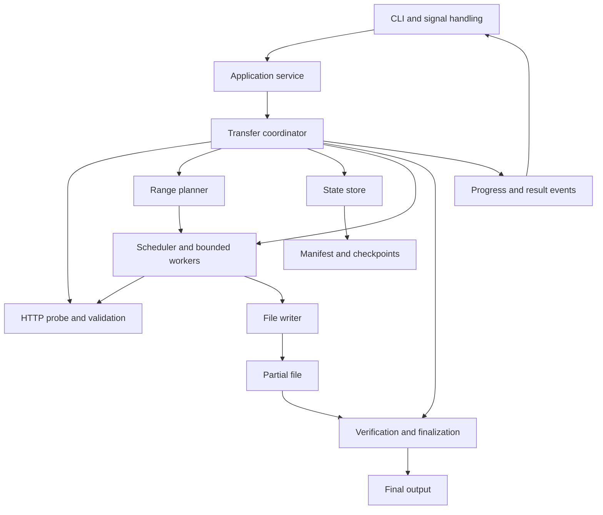
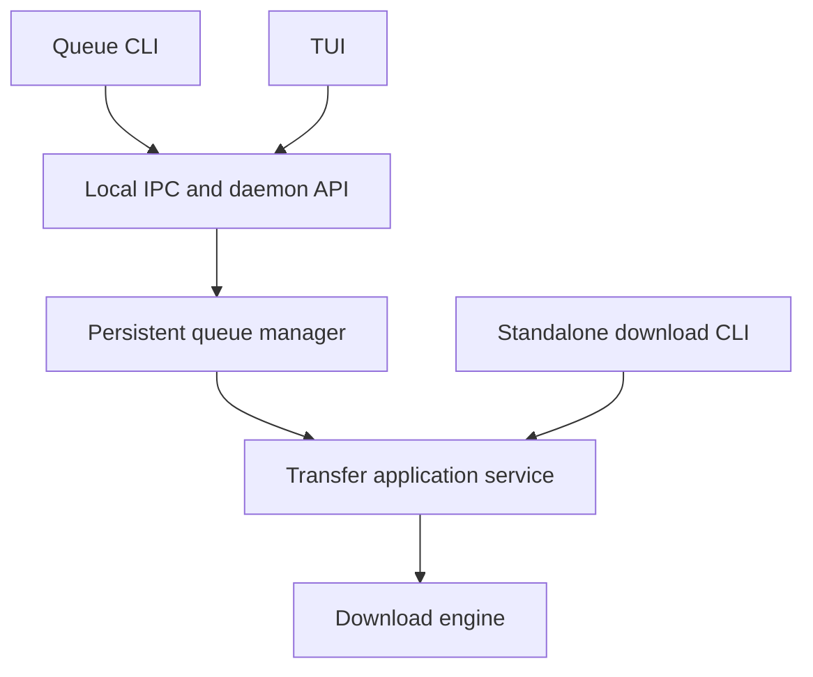

# Architecture

[Documentation index](README.md)

Milestones A and B and the first part of C implement the packages below. The diagrams and proposed layout describe the larger target architecture.

## Current packages

| Package | Implemented responsibility |
|---|---|
| `cmd/yoinkdl` | Entry point, build version, SIGINT/SIGTERM cancellation |
| `internal/cli` | Standard-library argument parsing, local inspection, stdout/stderr, terminal progress |
| `internal/transfer` | Sequential HTTP requests, fresh capability probing, immutable range identity, strict response validation, timeouts, byte checks, snapshots |
| `internal/ranges` | Bounded fixed-chunk planning, validated coverage, missing work, HTTP endpoint conversion |
| `internal/storage` | Stable OS locks, prefix/chunk manifests and checksums, durable checkpoints, preservation, publication recovery |

`transfer.Download` is the current application entry point. Storage verifies local bytes before transfer validates remote identity; only then may it truncate uncertain tails. `storage.Inspect` reads metadata without acquiring writer ownership or contacting the server. No separate app, scheduler, configuration, or progress package is needed for this slice. Tests live beside the code, including interruption and forced-process-crash checks in `cmd/yoinkdl`.

The chunk storage API is ready for a future coordinator: `BeginRanges`, `ContinueRanges`, and `CheckpointRange` share ownership and publication with sequential transfers. Checkpoints must be serialized, and the caller must validate each completed response before acknowledging its chunk. The current CLI still downloads sequentially and refuses partial range resume. Worker ownership, bounded offset writes, concurrent HTTP transfer, and cancellation during range finalization are not implemented yet.

The internal `probe` helper returns either a selected representation or an open full-response stream for sequential fallback. It creates no storage state. The future coordinator must call it only for fresh transfers after acquiring output ownership, close any returned stream, and use that stream's own metadata. `representation.request` and `representation.validate` bind subsequent range requests to the immutable identity; worker body validation remains required.

## Component flow



The CLI constructs a request and owns terminal interaction. The application service manages one transfer lifecycle. The coordinator chooses a plan, drives workers, persists safe progress, and authorizes finalization.

## Responsibilities

| Component | Owns |
|---|---|
| CLI | Parsing, display, error presentation, version command, process signals |
| Application service | Input validation, effective settings, lifecycle orchestration |
| HTTP transport | Probes, redirects, requests, response validation, timeout behavior |
| Planner | Sequential/ranged mode selection and non-overlapping intervals |
| Scheduler | Worker limits, task ownership, retry timing, cancellation |
| Storage | Destination policy, partial files, transfer identity, locks, checkpoints, final publication |
| Progress | Events and snapshots suitable for terminal and later daemon/TUI consumers |

These are responsibilities, not a requirement for a type or interface per row. Add a package only when its ownership is distinct.

## Proposed repository layout

```text
yoinkdl/
├── cmd/
│   └── yoinkdl/
│       └── main.go
├── internal/
│   ├── app/
│   ├── transfer/
│   ├── httpx/
│   ├── storage/
│   ├── progress/
│   └── config/
├── test/
│   ├── integration/
│   └── fixtures/
├── docs/
├── go.mod
├── README.md
└── LICENSE
```

| Proposed package | Scope |
|---|---|
| `cmd/yoinkdl` | Entry point and command wiring |
| `internal/app` | Use cases and lifecycle boundaries |
| `internal/transfer` | Coordinator, planner, scheduler, workers |
| `internal/httpx` | HTTP metadata, ranged requests, validators |
| `internal/storage` | Files, manifests, checkpoints, locking |
| `internal/progress` | Event definitions and progress snapshots |
| `internal/config` | Defaults and optional configuration |

The current checkout is smaller; see [development](development.md#current-checkout).

## Dependency boundaries

Prefer Go's standard library: `net/http`, `context`, `os`, `encoding/json`, `sync`, and `time`. A small CLI library is optional. A database is unnecessary for v0.1.

The transfer engine should not import terminal rendering or daemon code. Storage should not depend on CLI flags. Convert flags into a request before entering the engine. Keep range arithmetic independently testable from network and disk behavior.

Avoid a generic task framework, plugin system, or public SDK before the first transfer use case works. Concrete APIs can follow the implementation rather than preceding it.

## Transfer data

The conceptual request includes the source URL, destination, worker preference, retry policy, optional cap, and resume/overwrite intent. These are inputs to validate, not frozen Go fields.

The coordinator needs reliable representation metadata, the selected mode, interval ownership, completed coverage, and cancellation state. Persist only the information recovery can validate. Keep live counters distinct from durable checkpoints.

Snapshots should distinguish known and unknown totals and expose enough information for bytes, speed, ETA, and active workers. A progress subscriber must not decide whether a transfer is complete. Terminal success follows verification and final publication.

The exact event schema and subscriber behavior remain [open](decisions.md#command-and-output-decisions).

## Ownership and shutdown

One process owns a transfer's writable artifacts. Within that process, each worker owns one interval at a time. Shared metadata needs coordinated updates even when data writes target disjoint offsets.

A context from the CLI signal handler flows through the application, requests, workers, limiter, and retry waits. Shutdown waits for writes to stop before saving a final safe checkpoint or closing shared files.

See [concurrency](concurrency.md) and [resume and storage](resume-and-storage.md) for the invariants behind these boundaries.

## Future front ends



The daemon should reuse the same application service. The standalone command must remain useful without it. A TUI consumes snapshots and events rather than reaching into workers.

Unix domain sockets are a suggested local transport on Linux/macOS; Windows needs an appropriate equivalent. No fixed port, IPC schema, REST endpoints, or authentication protocol is committed. Those decisions belong to v0.2 design work.
