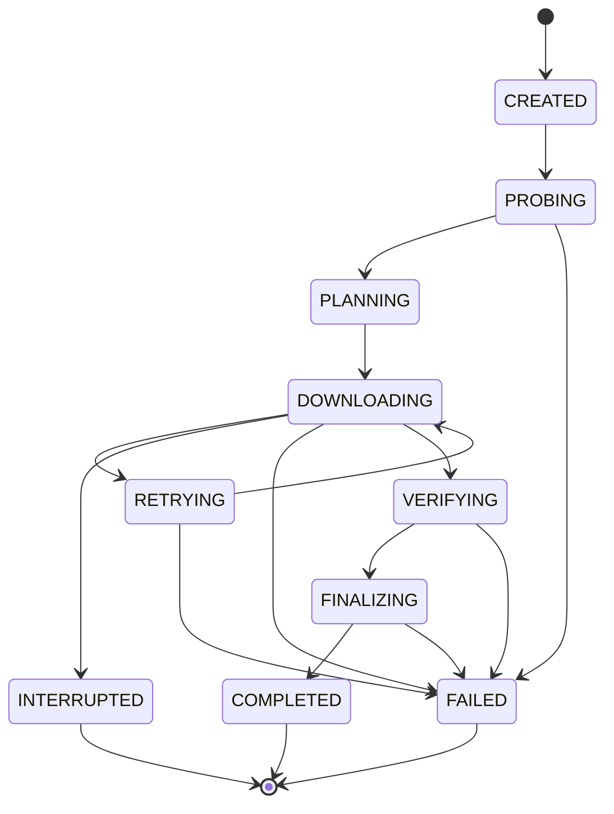

# Transfer lifecycle

[Documentation index](README.md)

This page defines the lifecycle intended for v0.1. State names are conceptual; serialized state and event schemas are not frozen.

Milestone A implements validation, a full HTTP GET, sequential streaming, completion checks, and publication. Metadata probes, range planning, retries, and durable checkpoints in the full lifecycle remain planned.

## States

The diagram shows the main path. Input validation, planning, checkpointing, and any network or file operation can fail. Cancellation can occur during probing, transfer, retry waits, or verification. Once publication commits, the result must be reconciled with the actual final file.

`INTERRUPTED` and `FAILED` end an invocation, not necessarily the usefulness of its partial data. A later invocation revalidates identity and state before re-entering the transfer path.

## 1. Validate input and destination

Accept HTTP(S) URLs, resolve the destination, and validate settings. Use safe derived filenames and enforce the explicit overwrite policy. Acquire exclusive transfer ownership before mutating sidecars.

An input error should be reported before avoidable network or disk work. An existing completed file must not be overwritten by default.

## 2. Probe the resource

Collect the effective URL, reliable length when available, and representation validators. `HEAD` is optional and not sufficient evidence of range support. A validated ranged `GET` can establish that support.

A failed `HEAD` does not by itself prove that a download is impossible. See [HTTP handling](http.md) for response-specific behavior.

## 3. Choose a plan

Use ranged transfer only when response behavior, size, encoding, and resource identity support safe combination. Otherwise use a sequential stream.

For known length, the planned intervals must cover the object without overlaps or gaps. For resumption, schedule only intervals that are not safely completed. File allocation is not completion evidence.

## 4. Initialize or recover storage

Create or validate the manifest and same-filesystem partial data file. Check identity, destination, local file usability, schema, and saved coverage before trusting a checkpoint.

Keep incompatible state intact until a deliberate restart policy applies. The exact incompatible-state interaction is an [open decision](decisions.md#storage-and-recovery-decisions).

## 5. Transfer and checkpoint

Workers fetch their assigned intervals and validate the responses before acknowledging completion. Writes must stay within owned intervals. Retryable failures return incomplete work to the scheduler without counting it twice.

Persist only progress that recovery may safely reuse. A conservative checkpoint can omit recently received bytes; it must not claim bytes that might be missing or undurable. See [checkpoint ordering](resume-and-storage.md#checkpoint-ordering).

## 6. Verify

| Mode | Required evidence |
|---|---|
| Known-length sequential | Successful transport completion and exactly the expected number of bytes |
| Ranged | Valid responses for one representation; every interval complete; exact coverage of the known object length |
| Unknown-length sequential | Clean, successful response completion with no reader or writer error |

Use interval coverage as well as byte totals. Two overlapping ranges can have the expected total byte count while leaving a hole. A preallocated file can have the expected filesystem length without having received its contents.

A retry counter, progress percentage, `200`, `206`, or `416` alone never proves completion. User-supplied checksums are deferred, but deterministic tests must compare exact fixture output.

## 7. Finalize

The intended publication sequence is:

1. Ensure every worker has stopped writing and verification succeeded.
2. Sync and close the partial file, checking errors.
3. Reconcile the destination with the overwrite policy at publication time.
4. Publish the verified file atomically on the same filesystem using a qualified platform strategy.
5. Remove obsolete transfer metadata when safe and report the final result.

The destination check must cover a file created after initial validation. A simple check followed by an unconditional rename can still replace someone else's file.

Atomic visibility and survival after power loss are separate guarantees. The design requires safe publication, but the implementation must qualify rename and directory durability behavior for each supported platform. Go's `os.Rename` can replace an existing file and does not promise atomic behavior on non-Unix platforms. [Go file operations](https://pkg.go.dev/os#Rename).

Failure to publish must not result in a success message. The current CLI reports a nonzero result and identifies verified published output when a later directory-sync or partial-cleanup error occurs. Manifest reconciliation after publication remains to be specified before resume is added.

## Interruption and failures

On a normal interrupt, cancel requests, stop workers, and attempt a safe final checkpoint. If checkpoint persistence fails, report it and trust only the previous durable state on restart.

For a crash, use the last valid checkpoint and re-fetch uncertain bytes. For disk or permission errors, preserve otherwise valid partial data where possible. Do not assume a `FAILED` transfer is resumable without inspecting its artifacts and resource identity again.
